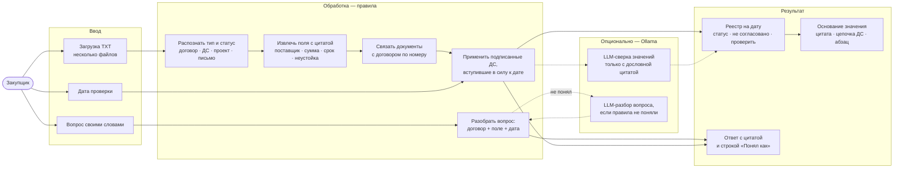
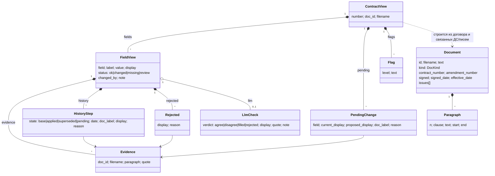
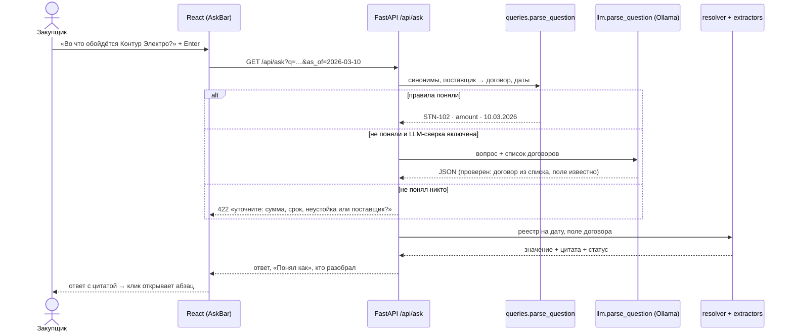

Тестовое задание на позицию Product Owner
# Сверка договоров поставки

Прототип для специалиста по закупкам. Загружаете TXT-документы (договоры, допсоглашения, письма, проекты) и получаете реестр действующих условий на дату проверки: номер, поставщик, сумма, срок поставки. Каждое значение кликается до точной цитаты и подсвеченного абзаца исходного файла. Несогласованные предложения показаны отдельно. Если значения в тексте нет, выводится «нет данных», а не догадка.

## Запуск

Требуется Python 3.10+ и Node.js 18+ (проверено: Python 3.12, Node 24, Windows 10; `start.sh` — Git Bash). Интернет нужен только для `pip`/`npm install`, шрифты собираются в бандл. Ollama не обязательна — без неё всё работает на правилах.

```bash
git clone https://github.com/kotpro95/Semantic-Text-Navigator.git
cd Semantic-Text-Navigator
```

```bash
./start.sh          # macOS / Linux
```
```powershell
.\start.ps1         # Windows PowerShell
```

Скрипт создаёт `.venv`, ставит зависимости, собирает фронтенд и запускает сервер. Дальше:

- приложение — http://localhost:8000
- API со Swagger — http://localhost:8000/docs

Режим разработки: `uvicorn app.main:app --app-dir backend --reload` и `npm run dev` в `frontend/` (http://localhost:5173, прокси на `/api`).

**Если не запустилось**
- Windows: «выполнение сценариев отключено» → `powershell -ExecutionPolicy Bypass -File .\start.ps1`.
- «Address already in use» / порт 8000 занят → остановите другой процесс на 8000 или запустите вручную с `--port 8001` (последняя строка `start.ps1` / `start.sh`).
- После обновления кода страница выглядит по-старому → Ctrl+Shift+R (сервер уже отдаёт `index.html` без кэша).
- Переключатель «LLM-сверка» серый → Ollama не запущена или модель не скачана; причина видна в подсказке «?» рядом.

Тесты:

```bash
cd backend && ../.venv/bin/python -m pytest -q      # Windows: ..\.venv\Scripts\python; .venv создаёт start-скрипт
```

Сейчас 66 тестов: эталонные ответы на 4 вопроса, мутации сценария встречи (изменённое поле, новый договор, статусы ДС), устойчивость к формулировкам, свободные вопросы (перефразировки, уточнение вместо догадки), логика LLM (модель подменяется), API.

**Опционально — LLM-сверка (Ollama), включается переключателем в шапке.** Без неё всё работает. Платные ключи не нужны, секретов в коде нет.

```bash
winget install Ollama.Ollama        # Windows; macOS: brew install ollama; Linux: curl -fsSL https://ollama.com/install.sh | sh
ollama pull qwen2.5:3b              # ~1,9 ГБ, работает на CPU (~30–40 с на договор на ноутбуке без видеокарты)
```

После этого в шапке приложения включите «LLM-сверка». Что делает модель:
- независимо читает текст каждого договора и называет сумму и срок поставки с цитатой;
- её ответ принимается, только если цитата дословно есть в тексте и не попадает под ловушки (аванс, лимит, срок оплаты);
- совпало с правилами — метка «LLM ✓»; расходится — «LLM ≠» и статус «Проверить»;
- правила дали «нет данных», а модель нашла значение с цитатой — значение показывается с меткой «LLM» и статусом «Проверить», но не подставляется молча.

Проверка идёт в фоне, прогресс виден рядом с переключателем. Другую модель или адрес задают переменные `OLLAMA_MODEL` и `OLLAMA_URL`. API: `GET /api/llm`, `POST /api/llm {"enabled": true}`.

## Сценарий использования

При первом открытии запускается интерактивный тур: экран затемняется, нужный элемент подсвечивается, анимированный курсор показывает наведение и клик, а карточка объясняет, что можно сделать с элементом. Разделы тура: загрузка, реестр, основание значения, вопросы, фильтры, настройка таблицы, LLM-сверка. Пройти тур заново можно кнопкой «Как пользоваться» в шапке. Управление в туре: «Далее» / → / Enter, «Назад» / ←, Esc — выйти. Там же переключатель темы «Светлая / Тёмная»: выбор запоминается, а при первом визите тема берётся из настроек системы.

1. «Выбрать файлы» или перетащить TXT. Для демо есть кнопка «Загрузить примеры» — файлы из `documents/`.
2. «Документы ▾» в шапке — распознанный тип и статус каждого файла («в силе с 01.03.2026», «проект, не подписан», «предложение»). Удаление требует подтверждения.
3. Реестр — плотная таблица в духе Excel на дату проверки (по умолчанию 10.03.2026, дата меняется в шапке).
   - Шапка и колонка «Договор» закреплены, колонки сортируются.
   - Колонки можно скрывать (в т. ч. «Выделить все»), переставлять («Колонки ▾») и тянуть по ширине (двойной клик по границе — сброс). Высоту строки меняют, потянув нижнюю границу ячейки «Договор»; двойной клик подгоняет высоту по содержимому — длинный текст переносится.
   - Переключатель плотности «Компактно / Стандартно». Настройки запоминаются в браузере.
   - Статус договора — квадратный маркер и текст, не только цвет: «□ Есть предложение», «■ Проверить» (оранжевый), «В силе» (серым). Метка «ДС1» у значения означает, что оно изменено подписанным ДС.
   - Фильтры «Проверить», «Есть предложение», «Поставка до даты», поиск по номеру или поставщику, сохранение своих фильтров.
   - Клавиатура: щёлкните по таблице, дальше стрелки двигают курсор ячейки, Enter открывает основание, Esc закрывает (подсказка внизу появляется, когда таблица в фокусе). Подсказки «?» объясняют термины.
4. Клик по значению или Enter открывает панель с основанием:
   - точная цитата;
   - цепочка «договор → ДС → проект»;
   - документ с подсвеченным абзацем;
   - «найдено, но не принято», например «252 000 — аванс», «600 000 — бюджетный лимит», «10.04.2026 — срок оплаты».
5. Поле «Спросите по загруженным договорам»: свой вопрос своими словами или один из 4 вопросов задания — они появляются подсказками под полем и фильтруются по вводу (стрелки + Enter). Под ответом — «Понял как: STN-102 · сумма · на 10.03.2026 · разобрал: правила». Как это устроено — ниже.

### Свободные вопросы: как обрабатываются и почему это не противоречит ТЗ

ТЗ разрешает «текстовый запрос» и не требует «произвольного чата». Поэтому вопрос не отправляется модели «на ответ», а переводится в **структурный запрос** — договор + поле + дата. Отвечают те же правила, что строят реестр: с цитатой, со статусом и «нет данных» вместо догадки.

1. **Правила (всегда, мгновенно).** Синонимы и словоформы: «цена / сколько платим / во что обойдётся» → сумма; «когда привезут / отгрузка / сроки» → срок поставки; «пени / штраф» → неустойка. Договор — по номеру или по названию поставщика («Контуру Электро» → STN-102). Даты: «на 1 марта 2026», «до 01.04.2026», «раньше апреля».
2. **LLM (только если правила не поняли и включена «LLM-сверка»).** Ollama возвращает JSON «договор / поле / дата». Ответ модели проверяется: договор — только из загруженных, поле — только из известных, дата — валидная. Частичные результаты объединяются: правила поняли договор, модель — поле → «разобрал: правила + LLM».
3. **Не поняли оба — уточняющий вопрос**, а не догадка: «Понял договор STN-102, но не понял, что нужно: сумма, срок поставки, неустойка или поставщик?».

Модель не формулирует ответ и не видит итоговых значений — галлюцинация не может попасть в ответ. Аналитические вопросы («какой договор дороже всех») и поля, которых прототип не извлекает (условия оплаты), не поддерживаются: в первом случае будет уточнение, во втором вопрос сведётся к ближайшему полю — это видно в строке «Понял как». Покрыто тестами `tests/test_questions.py` (перефразировки, «до апреля», дата из вопроса, уточнение вместо догадки, валидация и объединение ответа модели).

| Вопрос | Ответ прототипа на 10.03.2026 |
|---|---|
| Срок поставки STN-101 | **30.04.2026** — ДС № 1, п.2 (было 15.04; проект ДС № 2 с 10.05 не подписан) |
| Сумма STN-102 | **840 000 ₽** — п.2.1 (аванс 252 000 входит в неё и не является суммой) |
| Сумма STN-103 | **нет данных** — стоимость в приложении № 1, которого нет; 600 000 — лимит |
| Поставка до 01.04.2026 | **STN-102** (20.03), есть несогласованный перенос на 27.03 (письмо). Также видно, что по STN-101 есть несогласованный проект |

API (Swagger: `/docs`): `POST /api/documents` (multipart, несколько файлов), `POST /api/documents/samples`, `GET|DELETE /api/documents[/{id}]`, `GET /api/registry?as_of=`, `GET /api/contracts/{номер}?as_of=`, `GET /api/query?type=field|delivery_before`, `GET /api/ask?q=`, `GET|POST /api/llm`.

## Известные ограничения

- **Формат.** Правила рассчитаны на общий формат учебных договоров:
  - абзац — это строка;
  - есть строки «Дата:» и «Статус:»;
  - формулировки вроде «общая стоимость / сумма / цена / стоимость договора … N рублей» (в том числе с копейками и «₽»), «поставить не позднее / в срок до / до ДД.ММ.ГГГГ», «Пункт X договора изложить в редакции «…»», «… изменить на …», «вступает в силу ДД.ММ.ГГГГ».

  Другие формулировки дадут «нет данных» или «требует проверки», но не выдуманное значение.
- **Подписание** определяется только по строке статуса («подписан обеими сторонами»). Подписи и ЭЦП не проверяются.
- **Хранение.** Данные живут в памяти процесса: после перезапуска документы нужно загрузить заново. Пользователей и прав нет.
- **Номер договора** ищется по шаблону `ABC-123`. Документ без номера помечается как непривязанный.
- **Неустойка** извлекается с цитатой. По умолчанию колонка скрыта, включается в «Колонки ▾».
- **Значения не редактируются в таблице.** Ручная правка разорвала бы связь «значение ↔ цитата». Правильная форма — очередь «подтвердить или исправить с пометкой» (следующее улучшение № 1).
- **Ролей нет.** Нет кабинетов инициатора, поставщика и руководителя, нет мастеров создания процедур: пользователь прототипа — закупщик, задача — сверка.
- **LLM-сверка** перепроверяет только сумму и срок поставки и только по тексту договора (ДС/письма — правилами). На CPU медленно (~30–40 с на договор), результат кэшируется до перезапуска сервера.
- **Макет Figma** отстаёт от приложения: v2 ещё не переведён на вариант A (лимит вызовов Figma MCP на тарифе Starter). Источник правды по UI — код.
- **Вне объёма:** OCR, PDF и DOCX, свободный чат.

**Структура проекта**
```
backend/app/      main.py (FastAPI + раздача фронта), api.py, models.py, store.py (в памяти)
  parsing/        segment.py (абзацы, даты, суммы), classify.py (тип и статус документа)
  extractors/     base.py (реестр @register), fields.py (поставщик, сумма, срок, неустойка)
  amendments.py   изменения из ДС/проектов/писем · resolver.py — условия на дату · queries.py — вопросы
  llm.py          LLM-сверка и разбор вопроса через Ollama (опционально)
backend/tests/    golden, мутации и формулировки, свободные вопросы, LLM (модель подменяется), API
frontend/src/     App.tsx, components/ (DataTable, SourceDrawer, Panels, Tour, common), styles.css (темы)
documents/        учебный комплект (6 TXT) · docs/TIMELOG.md — затраты времени
```

---

## Записка PO

**Пользователь.** Специалист по закупкам. Сверяет условия поставок по пачке документов, не перечитывая их целиком. Ему важно две вещи: (а) действующее значение на дату и (б) чем подтверждено — чтобы показать юристу или поставщику.

**Пять вопросов клиенту перед развитием**
1. Откуда приходят документы (СЭД, почта, 1С) и в каком формате на самом деле? Какая доля сканов?
2. Кто и как подтверждает подписание: ЭДО и статус в СЭД или только текст? Можно ли брать статус из системы-источника?
3. Какие поля нужны кроме суммы и срока: неустойка, условия оплаты, НДС, спецификации? Что из этого решения (оплата, претензия), а что справка?
4. Что делать при противоречии: блокировать, эскалировать юристу, показывать оба варианта? Кто владелец решения?
5. Как часто сверяют на прошлую или будущую дату, нужна ли история «что действовало на дату X» для аудита?

**Принятые допущения**
- Правило задания: условие меняет только ДС, подписанное обеими сторонами и вступившее в силу к дате проверки.
- ДС без даты вступления в силу → не применяется, «требует проверки».
- Порядок ДС определяется датой вступления и номером. Имя файла и дата загрузки не влияют — это проверено тестом с переименованными файлами.
- Сумма — это «общая / итоговая стоимость договора». Аванс, лимит и «часть стоимости» суммой не считаются.
- Срок поставки — «поставить … не позднее / до»; срок оплаты и дата приёмки не учитываются.

**Метрики**
1. **Точность с источником.** Доля значений реестра, совпадающих с ручной разметкой юриста, при условии, что цитата подтверждает значение. Плюс отдельный счётчик выдуманных значений: цель — 0.
2. **Время сверки.** Минуты от загрузки пакета до ответа на вопрос закупщика (сейчас вручную) и доля ответов, принятых без открытия исходника. Вторая метрика показывает доверие к цитатам.

**Архитектура**

*Функциональная схема продукта* — что пользователь делает и какие функции за этим стоят:



*UML: диаграмма классов модели данных* (`backend/app/models.py`):



*UML: диаграмма последовательности — свободный вопрос* (`GET /api/ask`):



*Поток данных* (текстом):

```
TXT ─► segment (абзацы, смещения) ─► classify (тип, статус, даты — по тексту)
                                         │
                ┌────────────────────────┴───────────────┐
        договор: REGISTRY экстракторов          ДС/проект/письмо: amendments
        supplier · amount · delivery · penalty   «изложить в редакции «…»» → те же экстракторы
                └──────────────► resolver(as_of) ◄────────┘   «изменить/перенести … на …»
                     применить подписанные и вступившие ДС, остальное → pending
                     конфликты / нет данных → флаги «требует проверки»
                                         │
                 опционально: llm.py (Ollama) — второе мнение по тексту договора, только с дословной цитатой
                                         │
  вопрос ─► queries.parse_question (правила) ─► не понял? ─► llm.parse_question ─► тот же resolver
                FastAPI /api (registry, documents, query, ask, llm) ─► React: реестр, панель основания,
                                                                        вопросы, тур, светлая/тёмная тема
```

**Три ключевых решения и компромиссы**
1. **Правила, а не LLM, в основном пути.** Результат детерминирован, объясним и покрыт тестами. Работает без ключей и без GPU, и выдумать значение правила не могут. Минус — хрупкость к новым формулировкам. Смягчение: при сомнении «нет данных / проверить», а LLM-сверка (Ollama, включается переключателем) работает как второе мнение и страховка: её ответ принимается только с дословной цитатой и всегда со статусом «Проверить», если расходится с правилами или заполняет пропуск.
2. **Evidence как инвариант модели.** Любое значение несёт файл, номер абзаца и цитату, которая является подстрокой абзаца. Это проверяется кодом и тестом. Цена — экстракторы сложнее: приходится хранить предложение, а не только число. Взамен прослеживаемость и «найдено, но не принято».
3. **Реестр экстракторов + resolver на дату.** Новое поле (неустойка) добавляется одной функцией с `@register`. ДС переиспользуют те же экстракторы на тексте новой редакции. Дата — параметр запроса, а не константа. Минус — пересчёт на каждый запрос, но для десятков документов это миллисекунды.

**При 100 000 документов и правах доступа**
- Загрузка и парсинг уходят в асинхронную очередь. Результаты извлечения хранятся в БД (Postgres): документы, абзацы, значения с evidence. Resolver считается инкрементально по договору.
- Связывание договоров по номеру становится индексом. Для поиска по тексту — полнотекстовый или векторный индекс.
- Права доступа: RLS по подразделению или контрагенту, фильтр на уровне запроса. Аудит-лог просмотров и изменений.
- Качество: набор размеченных документов, регрессия точности на каждый релиз. LLM-извлечение — как второй контур на «нераспознанных» с обязательной проверкой цитаты.

**Три следующих улучшения (по приоритету)**
1. Очередь «требует проверки». Юрист подтверждает или исправляет значение — это одновременно новая разметка для метрики точности.
2. Устойчивость к формату: абзацы из нескольких строк, PDF и DOCX через извлечение текста, прочие формулировки сумм и сроков, LLM-кандидаты с проверкой цитаты.
3. Сохранение состояния и выгрузка реестра (XLSX/PDF) с цитатами для согласования.

## Отчёт о вайбкодинге

**Инструмент.** Claude Code (desktop) на модели Claude Opus 5.5.
- Через Figma MCP построен макет с токенами, компонентами и кликабельными переходами: [Figma](https://www.figma.com/design/mFUdSqFOLI2CxsvFRleqpm). Страница v1 — первая версия, v2 — плотная таблица (ещё не переведена на финальный стиль A: упёрлись в лимит вызовов Figma).
- Скилл UI/UX Pro Max дал три визуальных направления и правила доступности; выбрано направление A «Швейцарский реестр».

**Характерные запросы**
1. «Изучи ТЗ и примеры документов, задай вопросы» — сначала разбор ловушек (аванс, лимит, срок оплаты, проект, письмо), затем выбор стека и подхода.
2. «Давай прототип сразу в Figma» — макет, переходы, проверка WCAG-контраста токенов. Охра на охристом фоне давала 4.27:1, цвет затемнили.
3. «Правила основным путём, LLM опционально; каждое значение — цитата и абзац; тесты на сценарий встречи (изменённое поле, новый договор)».

**Ошибки ИИ и как найдены**
- **Pydantic.** Поле модели `date` перекрыло тип `date`, и `HistoryStep` падал с «Input should be None». Нашёл smoke-прогон на учебных файлах. Исправление: `import datetime as dt`.
- **Правка регулярки через `sed`.** Экранирование съело `\w`/`\s`, и признак «в день» у неустойки тихо пропадал. Ошибка видна в выводе («0,1%, не более 10%» без «в день»). Исправлено, закреплено тестом `test_penalty_extracted_with_quote`.
- **Figma.** `resize()` сбросил auto-layout в FIXED, и строки списка и вопросов схлопнулись. Прозрачность у заливки, привязанной к переменной, потерялась, и затемнение стало чёрным. Оба дефекта найдены по скриншоту и исправлены точечно.
- **UI.** Кнопка-источник оказалась вложена в кнопку-ячейку (невалидный HTML). `scrollIntoView` прокручивал всю панель вместо окна документа. Найдено на ревью кода и при проверке во встроенном браузере.

- **`start.ps1` на чистой машине.** Скрипт работал в окружении разработки, где `.venv` уже был. Прогон из свежего `git clone` выявил две ошибки Windows PowerShell 5.1:
  - при `$ErrorActionPreference = "Stop"` уведомление `pip` в stderr прерывало скрипт;
  - файл без BOM читался как Windows-1251, и кириллица ломала разбор.

  Исправление: явная проверка кодов выхода и скрипт только из ASCII-символов. Повторный прогон из чистого клона дал верные ответы на все 4 вопроса.

- **Неудачное продуктовое решение: перегруженный интерфейс.** Первая версия выносила в таблицу всё, что умеет бэкенд: ссылки «§ файл · ¶» в каждой ячейке, карточки документов, абзацы прозы о предложениях. Ревью глазами закупщика показало, что это мешает работе. Переделано в плотную таблицу в духе Excel, а детали и цитаты открываются по клику или Enter в панели основания.
- **Клавиатура.** Enter сразу после стрелок открывал не ту ячейку: обработчик читал состояние прошлого рендера. Найдено скриптовой проверкой в браузере, исправлено через `ref`.
- **Выдуманное время.** При обновлении TIMELOG ИИ вписал этапы «до 03:10», хотя на часах было 02:09. Поймано сверкой с системными часами и `git log`; лог переписан по реальным меткам коммитов.
- **Формулировки.** Стресс-тест на «тот же общий формат» показал, что не распознаются копейки, «Сумма/Стоимость договора…» и «в срок до …». Без исправления это дало бы «нет данных» на встрече. Исправлено, добавлено 13 тестов.

**Как проверялось.** pytest — 66 тестов (golden, мутации, формулировки, свободные вопросы, логика LLM, API). Запуск `start.ps1` и `start.sh` из чистого `git clone` с GitHub. LLM-сверка — на живой модели qwen2.5:3b: согласна с правилами по всем 6 значениям учебного комплекта, ловушки не взяла. В браузере: загрузка через интерфейс, новый договор STN-104, 4 вопроса, панель основания, тур (17 шагов, подсветка сверена скриптом с границами элементов), обе темы. Консоль браузера чистая.

Затраты времени — в [docs/TIMELOG.md](docs/TIMELOG.md).
